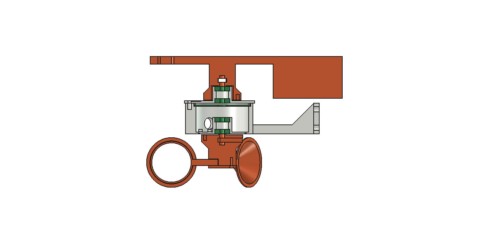

# Station mechanicals (3D printed, ASA, on 2020 profile)

Parametric models for everything a leaf needs outdoors: a combined wind kit
(vane above, cups below, one housing), a tipping-bucket rain gauge, a Stevenson
screen for the 4 x 6 cm sensor carrier, the core box for Board A and a loose
32xxx cell, and a bracket for a solar panel up to 70 x 100 mm.

**Status (2026-11-10): first design pass. Every part passes the automatic
checks below, but nothing has been printed or bench-tested.**

## Change something

1. Edit a value in `params.py`. Units are millimetres and every value is commented.
2. Run `./build.sh` (needs FreeCAD 1.x, takes about 30 s).
3. Read `out/report.md`.

The build protects you in three layers:

- `params.validate()` stops before any geometry is made if the numbers cannot
  work, and says which parameter to change.
- Each part must come out as one valid, watertight solid that sits on the bed
  and fits the printer.
- All parts are placed in the assembly and checked against each other for
  collisions.

To try a change without touching `params.py` or writing files:

    STATION_CHECK=1 STATION_SET="brg_od=10,brg_w=4,batt_l=66" ./build.sh

## Outputs (`out/`)

| Path | What |
|---|---|
| `print/*.3mf` | One mesh per part, already lying in its print orientation. No supports intended. |
| `step/*.step` | Exact geometry, for Onshape or any other CAD tool. |
| `station.FCStd` | Every part in place on a mock mast and crossarm. Objects open hidden because the file is written headless: select all and press space. |
| `report.md` | Sizes, masses, overhang audit, magnet-to-reed distances, hardware list. |

## Design decisions

**Mounting.** Every foot has four M5 holes in a cross, so any opposite pair
lands on the slot of a 2020 running either way. Mechanisms that need a drain
or cable path (rain gauge, screen) are turned 45 degrees to the cross so the
profile underneath never blocks them.

**Wind: one kit, not two.** Vane on top, cups underneath, sharing one housing
on a side arm (the Davis layout).

| | Combined kit (chosen) | Separate vane and cups |
|---|---|---|
| Cabling | one gland, one 5-core run, matches Board D and the GX16-5 | two runs to a junction |
| Sealing | one housing; both rotors' magnets work through solid plastic | two housings |
| Mounting | one foot at the mast top | needs a crossarm at the top |
| Air flow | cups see the arm's wake from one direction | cups and vane see the mast's wake |
| Service | open one lid for both sensors | each replaceable alone |

Each rotor is clamped onto an M5 screw that turns in two ball bearings held by
the housing. Nothing rotating passes a wire, and the housing has no hole a
magnet needs: the vane magnet sweeps over the lid above the reed PCB, the cup
magnet under the floor above a single reed. Set `brg_od`, `brg_w` to the
bearing you have; MR105, 695, 605 and 625 all build. Smaller is better for
the cups (lower starting threshold). De-grease the cup bearings and use light oil.

**Cups are cones, printed mouth-down**, one per arm, hooked into the hub and
held by a cap. A 45 degree cone needs no support and the arm prints flat, so
it is strong in the direction wind loads it. The vane rotor prints upside down
in one piece, spine on the bed.

**Rain gauge.** 110 mm collector (95 cm2, so 1 mm of rain is 9.5 ml). The
funnel prints upside down so its cone closes in at 45 degrees. The magnet
rides on one end of the bucket and passes the reed vertically: 6 mm away in
passing, about 9.3 mm at rest, which gives one closure per tip instead of a
reed that never opens. Two screw heads are the stops; turning them sets the
tip volume.

**Stevenson screen.** Three 45 degree louvres and a cap on a spoked base,
clamped by three M3 screws. The carrier slides into grooved rails, so its hole
pattern does not matter. Print it in white.

**Core box.** Back wall on the bed. Board A lies with its connector row facing
a connector bay at the bottom; all five cable entries (two glands, GX12-2,
GX12-3, GX16-5) are in the bottom wall and face the ground, each named on the
lid. The radio's own SMA passes out through the side wall. The cell sits in a
cradle above the board, held by a pad on the lid. Tongue-and-groove rim for a
bead of sealant or 1.5 mm cord. Mounting tabs are outside the sealed volume.

**Solar bracket** is separate from the box (no holes through the box top) and
mounts on the mast just above it, which also shades the box.

## Printing

0.4 mm nozzle, 0.2 mm layers, 3 walls, 15 to 20 % infill, on the Ender-3 V3 KE.

- No part needs supports. The report's overhang column lists what is left:
  small holes, nut-slot ceilings and short bridges.
- `vane_rotor` is 208 mm long and just fits the bed straight.
- `enclosure_body` is the largest footprint (163 x 159 mm): use a brim and a
  draught shield against ASA warping.
- Print `wind_spacer` x2, `wind_shim` x2, `cup_arm` x3, `screen_plate` x3.
- Bearing pockets are modelled 0.1 mm over nominal. Print one `wind_lid` first
  and check the fit before printing the body.

## Not yet verified (do these on the bench)

1. **Magnet strength.** Distances are in the report. If three vane positions
   close at once, the magnet is too strong: raise `pcb_standoff` or use a
   smaller magnet. If none close between sectors, add a second disc
   (`vane_mag_n = 2`). The rain gauge wants a small magnet (4 x 2 or 3 x 1).
2. **Rain calibration.** Tip volume is set by the stop screws and has to be
   measured (pour a known volume slowly, count tips); the mm-per-tip figure
   used downstream follows from it and will differ from the SparkFun bucket's.
3. **Anemometer factor.** One closure per revolution, as the firmware assumes,
   but `ANEMO_MS_PER_HZ_X1000` in `firmware/leaf/src/config.h` belongs to the
   cups in service today; these cups need their own value from a drill test.
4. **Board A underside.** The corner with no mounting hole (under the radio)
   sits on an edge rest 2 mm wide; check nothing on the board's underside is there.
5. **Cell length.** Defaults fit a 32700 (71 mm). For a 32650 set `batt_l = 66`.
6. **Antenna.** The SMA only just reaches the outer wall face; the hole is wide
   enough for the antenna's connector body to enter. Seal round it.

## Not designed yet

- PMS7003 bay in the screen (the repo's architecture puts it beside the carrier).
- Insect and leaf mesh for the rain funnel.
- Frame joints: use standard metal 2020 corner brackets, not printed ones.

## Files

`params.py` dimensions and checks, `lib.py` modelling helpers, `wind.py`,
`rain.py`, `screen.py`, `enclosure.py` (box and solar bracket), `build.py`
build, checks and report, `docs/` renders.
