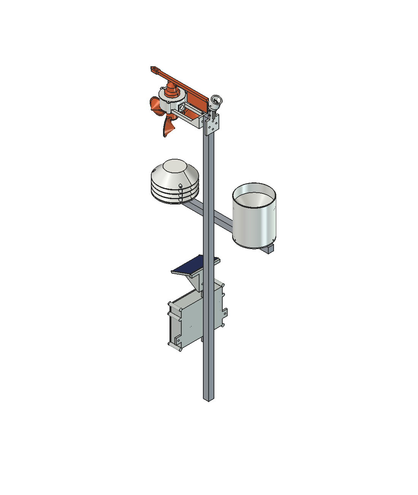
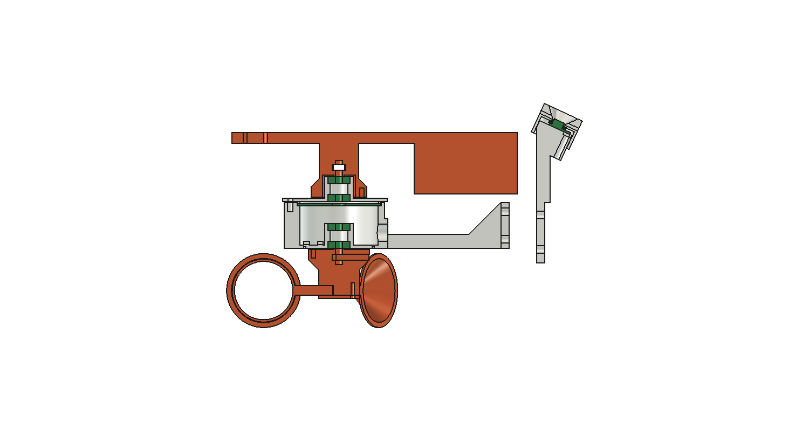
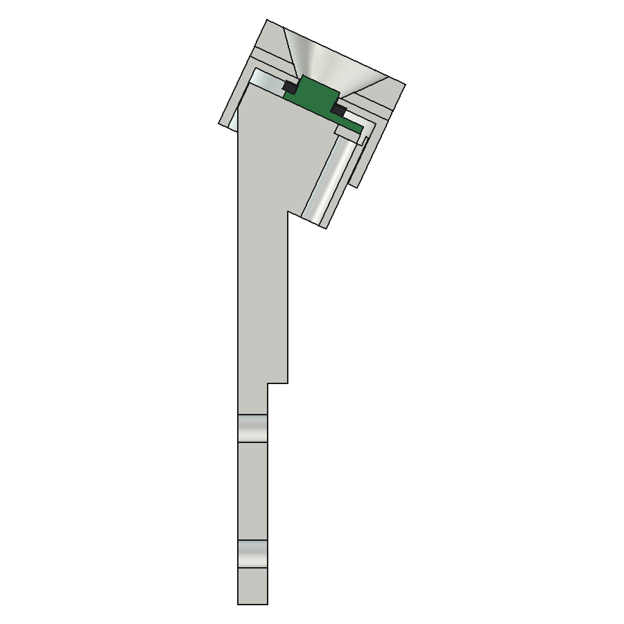

# Station mechanicals (3D printed, ASA, on 2020 profile)

Parametric models for everything a leaf needs outdoors: a combined wind kit
(vane above, cups below, one housing), a tipping-bucket rain gauge, a Stevenson
screen for the 58 x 70 mm sensor carrier (Board B), a sky pod for an MLX90614 cloud sensor, the core box for Board A and a loose
32xxx cell, and a bracket for a solar panel up to 70 x 100 mm.

**Status (2026-11-10): first design pass. Every part passes the automatic
checks below, but nothing has been printed or bench-tested.**

## Change something

1. Edit a value in `params.py`. Units are millimetres and every value is commented.
2. Run `./build.sh` (needs FreeCAD 1.x, takes about 35 s).
3. Read `out/report.md`.

The build protects you in three layers:

- `params.validate()` stops before any geometry is made if the numbers cannot
  work, and says which parameter to change.
- Each part must come out as one valid, watertight solid that sits on the bed
  and fits the printer.
- All parts are placed in the assembly and checked against each other for
  collisions.

To try a change without touching `params.py` or writing files:

    STATION_CHECK=1 STATION_SET="brg_od=10,brg_w=4,batt_l=66" ./build.sh

## Outputs (`out/`)

| Path | What |
|---|---|
| `print/*.3mf` | One mesh per part, already lying in its print orientation. No supports intended. |
| `step/*.step` | Exact geometry, for Onshape or any other CAD tool. |
| `station.FCStd` | Every part in place on a mock mast and crossarm. Objects open hidden because the file is written headless: select all and press space. |
| `report.md` | Sizes, masses, overhang audit, magnet-to-reed distances, hardware list. |

## Design decisions

**Mounting.** Every foot has four M5 holes in a cross, so any opposite pair
lands on the slot of a 2020 running either way. Mechanisms that need a drain
or cable path (rain gauge, screen) are turned 45 degrees to the cross so the
profile underneath never blocks them.

**Wind: one kit, not two.** Vane on top, cups underneath, sharing one housing
on a side arm (the Davis layout).

| | Combined kit (chosen) | Separate vane and cups |
|---|---|---|
| Cabling | one gland, one 5-core run, matches Board D and the GX16-5 | two runs to a junction |
| Sealing | one housing; both rotors' magnets work through solid plastic | two housings |
| Mounting | one foot at the mast top | needs a crossarm at the top |
| Air flow | cups see the arm's wake from one direction | cups and vane see the mast's wake |
| Service | open one lid for both sensors | each replaceable alone |

Each rotor is clamped onto an M5 screw that turns in two ball bearings held by
the housing. Nothing rotating passes a wire, and the housing has no hole a
magnet needs: the vane magnet sweeps over the lid above the reed PCB, the cup
magnet under the floor above a single reed. Set `brg_od`, `brg_w` to the
bearing you have; MR105, 695, 605 and 625 all build. Smaller is better for
the cups (lower starting threshold). De-grease the cup bearings and use light oil.

**Sky pod (cloud cover).** The MLX90614 reads the average temperature of
everything in its view, so it has to see only sky. The one place on the station
with nothing above it is just over the mast top. The pod bolts to the mast face
opposite the wind arm and holds the sensor 65 mm above the mast top, 7 mm above
the highest point of the vane, leaning 25 degrees away from the mast. The can
sits 8 mm down a cone that trims its view to +/-40 degrees and keeps sun off the
can body; it stands 1 mm proud of the cone floor, which drains both ways, so
water does not sit on the window. A TPU ring seals round the can. The wind arm
is 124 mm long so the vane tail clears the pod by 10 mm.

**The rotor shaft is an M5 x 40 socket-head screw**, not a rod or a dowel
pin. The screw does three jobs a plain shaft cannot: its head holds the rotor
in, tightening it clamps both bearings' inner races and the hub into one rigid
stack, and its 8.5 mm head is the only fastener that passes the 9.15 mm hole
in the vane PCB (an M5 nut is 9.2 mm across its corners). Buy it part-threaded
if you can, so the smooth shank sits in the bearings.
- *Dowel pins* are the wrong part: hardened carbon steel rusts outdoors, they
  are ground slightly oversize (to press into a hole) so a bearing will not
  slide on, and they cannot be drilled or threaded to hold a rotor.
- *5 mm stainless rod* would run truer than a screw, but needs a way to fix
  the rotor and a collar under each bearing pair, and a standard 10 mm collar
  does not pass the PCB hole. Worth revisiting only if the rotors visibly wobble.

**Cups are cones, printed mouth-down**, one per arm, hooked into the hub and
held by a cap. A 45 degree cone needs no support and the arm prints flat, so
it is strong in the direction wind loads it. The vane rotor prints upside down
in one piece, spine on the bed.

**Rain gauge.** 110 mm collector (95 cm2, so 1 mm of rain is 9.5 ml). The
funnel prints upside down so its cone closes in at 45 degrees. The magnet
rides on one end of the bucket and passes the reed vertically: 6 mm away in
passing, about 9.3 mm at rest, which gives one closure per tip instead of a
reed that never opens. Two screw heads are the stops; turning them sets the
tip volume.

**Stevenson screen.** Five 45 degree louvres and a cap on a spoked base,
clamped by three M4 x 80 socket-head screws with M4 nuts; 138 mm across, 106 mm tall, with a 76 mm sensor
chamber. The carrier (Board B, 58 x 70 mm) slides into grooved rails and rests on
its two bottom corners, so its hole pattern does not matter. Its sensors are soldered
on its front; the PMS7003 (or a PMS5003) lies on its back, between the rails. Its one
cable plugs into J1 facing down, in the 18 mm left free under the board, and leaves
through the hole in the base. The DFRobot lightning module (SEN0290, 30 x 22 mm) hangs
flat under the cap, parts side down, off the board's front: two M3 x 6 screws into
heat-set inserts in two bosses on the cap's underside, plus a rib under its connector end.
Its Gravity cable runs to J2. Print it in white.

**Core box.** Back wall on the bed. Board A lies with its connector row facing
a connector bay at the bottom; all five cable entries (GX16-8, GX12-2,
GX12-3, GX16-5, GX12-4) are in the bottom wall and face the ground, each named on the
lid. The cell sits in a cradle above the board, held by a pad on the lid.
Mounting tabs are outside the sealed volume.

**Antenna stays inside the box.** The right-angle stubby screws onto the
radio's own SMA and points up in a bay at the right-hand end, resting in a
saddle. There is no antenna hole. ASA is close to transparent at 868 MHz; what
costs signal is metal near the whip, so the layout keeps it 34 mm from the
cell and puts the mounting tabs 15 mm left of centre, which leaves 64 mm
between the whip and the aluminium mast. Expect a few dB less than the same
antenna in free air, and a weaker lobe in the direction where the mast is
behind the whip: hang the box on the side of the mast that faces the
coordinator. Keep the whip vertical; a cross-polarised link loses far more
than the box does. `ant_elbow`, `ant_d` and `ant_len` are estimated from the
product photo and need measuring.

**Seals (TPU).** `tpu_box_lid_gasket` lies in the rim groove and a narrow
ridge on the lid presses 0.3 mm into it. `tpu_wind_lid_gasket` sits between
the wind housing and its lid. `tpu_washer_*` go under the flange of each GX
socket and gland. `tpu_sky_can_seal` goes round the thermopile's can. Nothing else needs one: the rain gauge and screen are meant
to be open, and the wind rotors are sealed by overlap, not by contact.

**Solar bracket** is separate from the box (no holes through the box top) and
mounts on the mast just above it, which also shades the box.

## Which way round

Turn the mast so the sky pod's face points north (in the northern hemisphere).
Everything else follows from that:

| Mast face | What goes on it |
|---|---|
| North | sky pod, at the very top |
| South | wind arm at the top; lower down the solar bracket, with the box under it |
| East / west | the crossarm, with the rain gauge on one end and the screen on the other |

The pod then leans away from the sun's path, the panel faces the sun, and the
box sits in the panel's shade. Hang the box so its antenna end is on the side
toward the coordinator.

## Cables

| From | Leaves through | Route | Box port |
|---|---|---|---|
| Wind kit | PG7 gland in the housing wall, facing the mast between the two arm rails | along a rail (tie slot provided), down past the foot, then down the mast's slot | WIND, GX16-5 |
| Sky pod | slot through the plug, out under the head | down the riser (tie notches), down the mast's slot | SKY, GX12-4 to Board A's Qwiic port: 1 VBAT, 2 GND, 3 SDA, 4 SCL |
| Rain gauge | the drain opening beside the reed post | along the crossarm slot, down the mast | RAIN, GX12-3 |
| Screen | hole in the base, from Board B's J1 (XH-8) | along the crossarm slot, down the mast | ENV, GX16-8; inside, a pigtail splits it to Board A J4 (XH-5, pins 1 to 5) and J5 (XH-4, pins 6, 2, 7, 8) |
| Solar | hole in the tray floor | straight down | SOLAR, GX12-2 |

Every entry is in the box's bottom wall. Leave a drip loop below each plug so
water running down the cable falls off before the connector. 2020 slot covers
hold a 4 to 5 mm cable in the mast.

## Printing

0.4 mm nozzle, 0.2 mm layers, 3 walls, 15 to 20 % infill, on the Ender-3 V3 KE.

- No part needs supports. The report's overhang column lists what is left:
  small holes, nut-slot ceilings and short bridges.
- `vane_rotor` is 208 mm long and just fits the bed straight.
- `enclosure_body` is the largest footprint (163 x 159 mm): use a brim and a
  draught shield against ASA warping.
- Print `wind_spacer` x2, `wind_shim` x2, `cup_arm` x3, `screen_plate` x5.
- Two ASA colours: the vane and cups (`vane_*`, `cup_*`) in a second colour, any
  tone; everything else white. `build.py` tags each part in `out/parts.json` and
  the print tracker never puts two colours on one plate.
- TPU parts (`tpu_*`): 95A, 100 % infill, flat on the bed, slow. Quantities are
  in the report (`tpu_washer_gland` x1, `tpu_washer_gx12` x3, `tpu_washer_gx16` x2).
- `sky_mount` prints with the mast face down, `sky_head` upside down. Print
  both in white.
- Bearing pockets are modelled 0.1 mm over nominal. Print one `wind_lid` first
  and check the fit before printing the body.

## Not yet verified (do these on the bench)

1. **Magnet strength.** Distances are in the report. If three vane positions
   close at once, the magnet is too strong: raise `pcb_standoff` or use a
   smaller magnet. If none close between sectors, add a second disc
   (`vane_mag_n = 2`). The rain gauge wants a small magnet (4 x 2 or 3 x 1).
2. **Rain calibration.** Tip volume is set by the stop screws and has to be
   measured (pour a known volume slowly, count tips); the mm-per-tip figure
   used downstream follows from it and will differ from the SparkFun bucket's.
3. **Anemometer factor.** One closure per revolution, as the firmware assumes,
   but `ANEMO_MS_PER_HZ_X1000` in `firmware/leaf/src/config.h` belongs to the
   cups in service today; these cups need their own value from a drill test.
4. **Board A underside.** The corner with no mounting hole (under the radio)
   sits on an edge rest 2 mm wide; check nothing on the board's underside is there.
5. **Cell length.** Defaults fit a 32700 (71 mm). For a 32650 set `batt_l = 66`.
6. **Antenna size and range.** Measure the antenna and set `ant_elbow`,
   `ant_d`, `ant_len`; the box grows to suit. Then compare RSSI with the lid
   on and off at a fixed distance. If the loss matters, the fallback is an SMA
   bulkhead pigtail through the bottom wall.
7. **Gasket squeeze.** 0.3 mm into 95A TPU is a guess at what six M3 screws
   close comfortably. If the lid bows between screws, lower `gasket_squeeze`.
8. **Sky sensor.** (a) Read the letters on the can: BAA is 3 V with a 90 degree
   view, which this pod assumes; AAA needs 5 V and will not run from the
   battery rail; BCC sees 35 degrees. (b) The breakout's sizes in `params.py`
   are the usual ones, not measured. (c) The sensor draws about 1 to 2 mA
   whenever powered, far above this leaf's budget; sleep it over SMBus (3 V
   versions only) or gate its supply, and check the breakout's own regulator
   and pull-ups against the one-set-of-pull-ups rule. (d) Compare its reading
   with the screen's air temperature, not its own body temperature. (e) Rain
   or dew on the window reads as cloud; gate on the rain gauge as planned.
9. **The box is now airtight**, so it will breathe through its weakest seal as
   it heats and cools. Fit a membrane vent plug in the bottom wall if
   condensation shows up.

## Considered and left out: foam in the box

Spraying PU foam into the box, or into a wall cavity, is not worth doing here.
- The board dissipates 0.1 to 0.3 W. Insulation cannot keep a cell warm with
  that little heat behind it, and in sun it only delays the peak.
- Canned foam is partly open-cell: it takes up water and holds it against the
  electronics, which is the opposite of what the gasket is for.
- It expands hard enough to bow a printed wall or lift the lid seal, and it
  makes the cell and board impossible to service.
- It is flammable, around a lithium cell.

What does the same jobs better: the solar bracket shading the box, white ASA,
a silica gel sachet, a membrane vent, conformal coating on the board if
condensation appears, and a sleeve of closed-cell foam round the cell alone if
winter charging becomes a problem.

## Not designed yet

- Insect and leaf mesh for the rain funnel.
- Frame joints: use standard metal 2020 corner brackets, not printed ones.

## Buying

[BOM.md](BOM.md) lists every bought-in part with quantities, shop listings and
the filament estimate and source (two 1 kg spools of white ASA).

## Files

`params.py` dimensions and checks, `lib.py` modelling helpers, `wind.py`,
`rain.py`, `screen.py`, `enclosure.py` (box and solar bracket), `sky.py`, `build.py`
build, checks and report, `docs/` renders.
